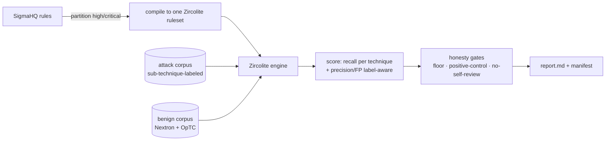

# sigmaforge

**Honest Sigma-rule backtest harness.** Measures detection rules against real log
corpora and reports two numbers per rule — **recall** (does it catch attacks of its
ATT&CK sub-technique?) and **precision / false-positives** (does it fire on benign
activity?) — with honesty gates that return `unmeasured` instead of a fake `0` or a
tautological `1.0` when the data can't support a number.

[](https://github.com/duathron/sigmaforge/actions/workflows/ci.yml)


> [!NOTE]
> **Learning / portfolio project, built by directing AI coding agents.** Christian
> Huhn (photography → SOC career change) designed, reviewed, and gated the work; the
> implementation was AI-pair-programmed. It is an honest measurement harness, not a
> polished product — see *Status* below for exactly what works and what doesn't yet.

## What problem it solves

Every SOC ships dozens to hundreds of detection rules and rarely measures them.
sigmaforge answers two questions with reproducible evidence:

- **Which rules are noise generators?** (high false-positives on legitimate activity)
- **Which rules catch nothing?** (zero recall against real attacks of their technique)

Example finding from a real run: *Suspicious Windows Service Tampering* produced 66
false-positives on a benign corpus — every one a Ninite / TeamViewer installer, not
an attack.

## How it actually works



The pipeline is one module (`sigmaforge.pipeline`); the CLI and the
`scripts/run*_backtest.py` runs call the **same** code — there is no weaker shipped
path. Two verbs, split by honesty (you cannot compute recall/precision without labels):

```bash
# pip-runnable: rules x ARBITRARY logs -> hits only (no labels -> precision/recall = unmeasured).
# Needs only the engine, no corpora.
sigmaforge hunt --rules my_rules/ --logs /path/to/logs

# the real measurement: rules x LABELED corpora -> per-technique recall + label-aware
# precision + honesty gates + report.md + manifest.json. Needs the corpora (else it
# prints a teaching error and points you at `hunt`).
sigmaforge backtest --rules my_rules/ --config sigmaforge.yaml
```

`--rules` takes a single `.yml` or a directory (auto-compiled). The engine + corpora
are not bundled (see *Reproduce a backtest*); the committed `reports/run*.md` are
inspectable without running anything.

## Status

| Area | State |
|------|-------|
| Recall (per sub-technique, no sibling dilution) | **Working** — 338/609 rules measurable, 70 fire (run5) |
| Precision / false-positives (label-aware, gated) | **Working** — 7/609 measurable on current benign corpus (run6) |
| Honesty gates (floor, positive-control, no-self-review) | **Working** |
| Reproducible manifest (run_hash, corpus SHAs, provenance) | **Working** |
| One-command CLI (`sigmaforge backtest` + `hunt`) | **Working** — same pipeline as the scripts (extracted to `sigmaforge.pipeline`); `hunt` is pip-runnable without corpora |
| Self-generated benign corpus | **Kit ready** (`scripts/selfgen/`), needs a Windows VM run |

> [!IMPORTANT]
> **The log corpora are not shipped.** They are large, separately licensed, and
> gitignored. `pip install sigmaforge` installs the harness code, not the data — a
> full end-to-end backtest needs the corpora and a local Zircolite checkout (also not
> bundled). The package is useful as a library / reference; the runnable pipeline
> needs the local setup documented in `scripts/`.

## Install

```bash
pip install sigmaforge
```

Installs the harness package and the `sigmaforge` CLI. The detection engine
([Zircolite](https://github.com/wagga40/Zircolite)) and the log corpora are obtained
separately (see above).

## Corpora used (all verified, portfolio-safe licenses)

| Corpus | Role | License |
|--------|------|---------|
| [splunk/attack_data](https://github.com/splunk/attack_data) | recall (sub-technique-labeled attacks) | Apache-2.0 |
| [DARPA OpTC](https://github.com/FiveDirections/OpTC-data) | precision (real enterprise benign week) | Public domain |
| [NextronSystems/evtx-baseline](https://github.com/NextronSystems/evtx-baseline) | precision (goodware baseline) | Apache-2.0 |
| Self-generated (`scripts/selfgen/`) | precision (targeted admin/LOLBin noise) | your own lab |

## Reproduce a backtest from a clone

The pip package is the library/CLI; a full end-to-end backtest needs the engine and
corpora, which are not bundled (engine = large third-party tool; corpora = large and
separately licensed). To go from a fresh clone to a runnable backtest:

```bash
uv sync --group backtest          # script deps (pyyaml, evtx, gdown)
bash scripts/setup_engine.sh      # fetch Zircolite 3.7.6 (pinned commit, verified) + hash-checked runtime deps
```

Run `setup_engine.sh` **after** `uv sync` and do not re-sync afterwards: an exact
`uv sync` uninstalls the engine's dependencies again (re-run the script if you do).

The script clones the pinned engine fresh on every run (commit and tree are checked, the
requirements are hash-locked) and moves any existing `Zircolite/` aside to
`Zircolite.old.<timestamp>` instead of trusting or deleting it. sigmaforge does not re-verify the
engine at run time: the check happens at setup only.
Setup needs network access on every run. Leftovers: `Zircolite.setup.*` after a failed clone or
verification (inspect it, then remove it yourself) and `Zircolite.old.*` after each run; both are
git-ignored. The installed `Zircolite/` directory gets mode 0755 (`mktemp` would create 0700).

Then obtain the corpora (see the table above) into `~/sigmaforge-v0/` and build the
combined samples with the `scripts/build_*_benign.py` / `scripts/build_*_corpus.py`
helpers, compile the ruleset, and run a backtest:

```bash
uv run python scripts/compile_loaded_ruleset.py   # SigmaHQ rules -> one Zircolite ruleset
uv run python scripts/run7_backtest.py            # -> reports/run7.md (+ manifest)
```

The `scripts/run*_backtest.py` and `scripts/compile_loaded_ruleset.py` helpers use
this checkout as the engine root when `SIGMAFORGE_HOME` is unset (the `Zircolite/` that
`setup_engine.sh` cloned next to them); set `SIGMAFORGE_HOME` to use an engine kept
elsewhere. The `reports/run*.md` + `*_manifest.json` are committed so the results are
inspectable without re-running.

### Where the engine comes from

The `sigmaforge` CLI never searches the current directory for an engine. It uses, in
order: `--engine-home`, then `backtest.engine_home` from the config file, then
`$SIGMAFORGE_HOME`; a value that does not contain `Zircolite/zircolite.py` (or an empty
`--engine-home` / `engine_home: ""`) is an error (exit 3), never a fallback. The engine is
third-party code that runs with your privileges, so the engine path, `SIGMAFORGE_HOME`
and `SIGMAFORGE_ZIRCOLITE` are part of your trusted environment: do not point them at
directories you did not set up (a relative `SIGMAFORGE_HOME` resolves against the current
directory). `SIGMAFORGE_ZIRCOLITE` only replaces the interpreter prefix of the engine
command (default: the Python running sigmaforge); the absolute engine script path is
always appended. Config files come from `--config` or `~/.sigmaforge/config.yaml`; a
`config.yaml` in the current directory is not read. Every path in a config file (`rules`,
`attack_corpus`, `technique_map`, `benign_sample`, `comiset_mapping`, `engine_home`) is
resolved relative to that file, with `~` expanded. See the manual (`sigmaforge manual`).

## Development

Built with the [Shipwright](https://github.com/duathron/shipwright) dev framework.

```bash
uv sync --dev
uv run pytest        # 113 tests (engine-dependent tests skip without Zircolite)
uv run ruff check .
```

## License

MIT © Christian Huhn. Corpus data retains its upstream license (see table above).
